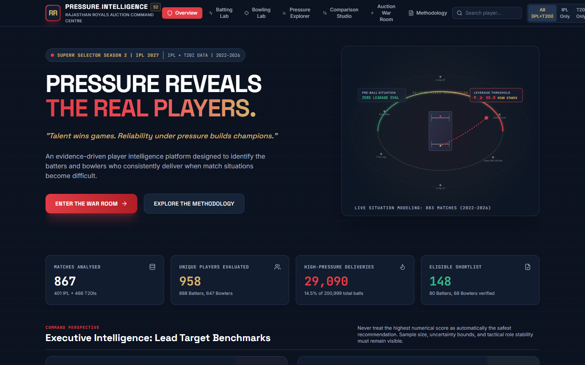
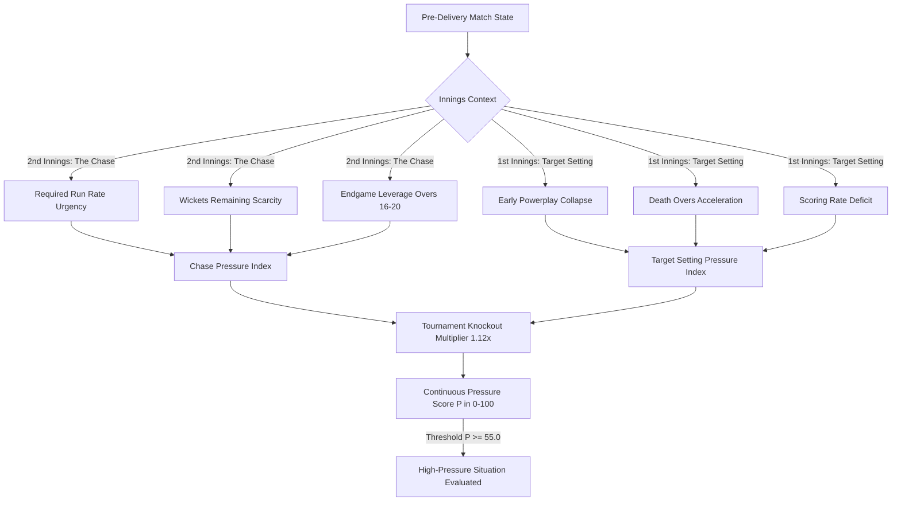
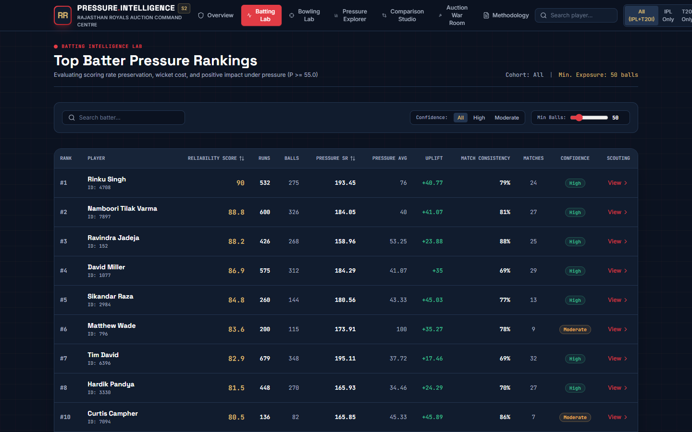
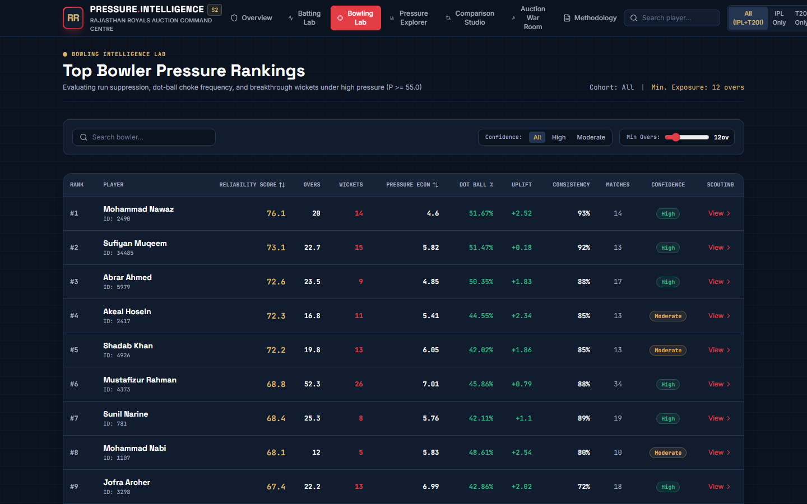
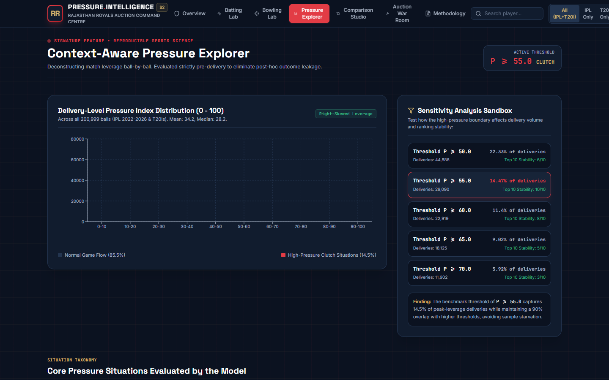
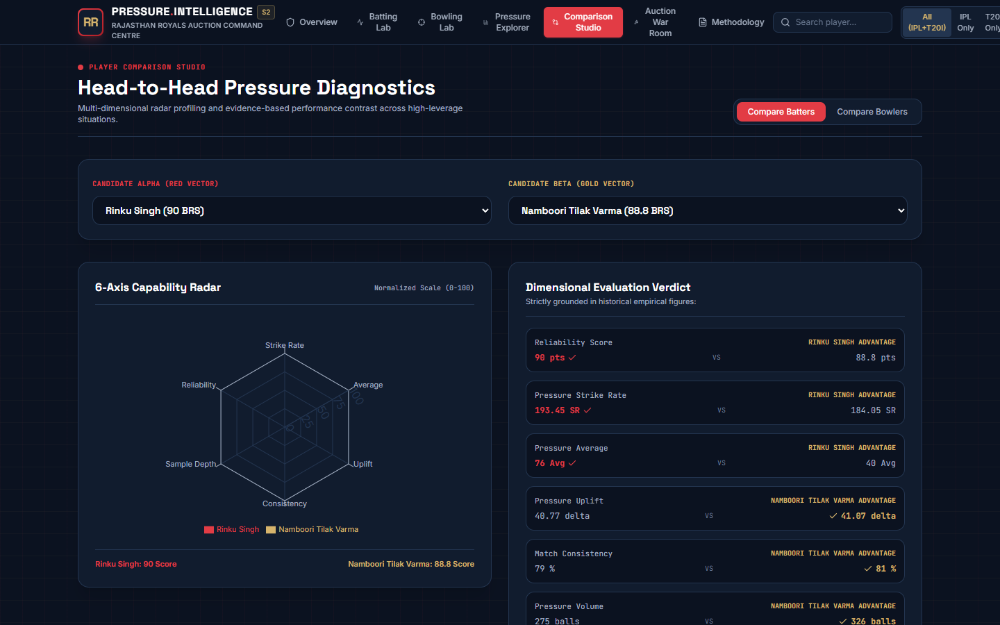
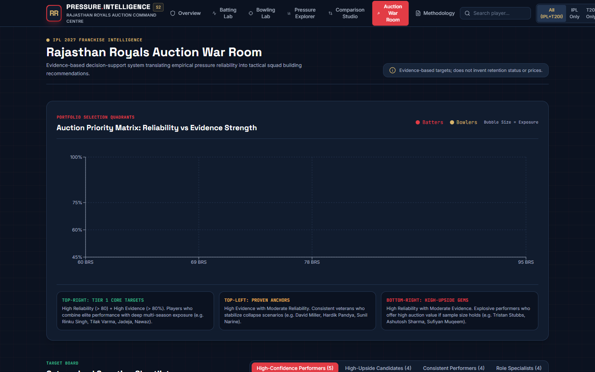
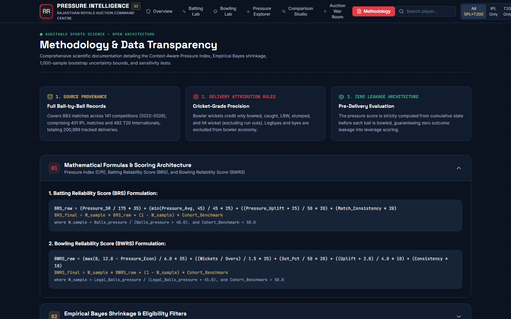
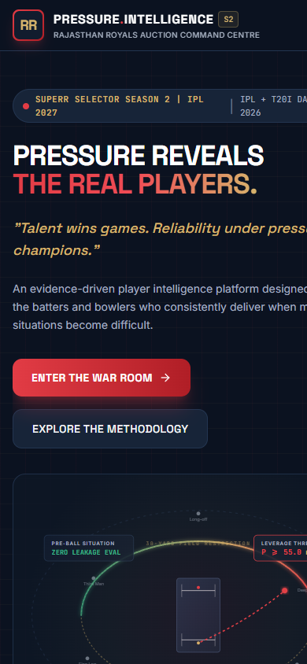
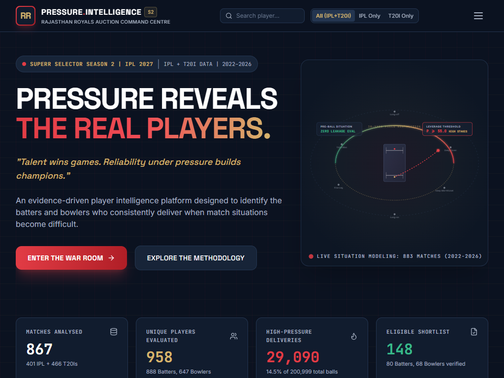

<div align="center">

# 👑 RR PRESSURE INTELLIGENCE
### IPL 2027 AUCTION ANALYTICS COMMAND CENTRE

**"WHEN THE GAME TIGHTENS, TRUST THE ONES WHO DELIVER."**  
*Decoding pressure performance. Discovering auction value. Building match-winning squads.*

[](https://unstop.com)
[](https://www.rajasthanroyals.com)
[](#-the-cricket-dataset-in-numbers)
[](https://react.dev)
[](https://vitejs.dev)
[](https://tailwindcss.com)

<br />

```
========================================================================================
🏆 ROUND 1 CHALLENGE: IDENTIFY THE MOST RELIABLE PLAYERS UNDER PRESSURE
Historical IPL & T20I Ball-by-Ball Data (2022–2026) • 883 Matches • Zero Outcome Leakage
========================================================================================
```

<br />



</div>

---

## ⚡ Executive Summary

Traditional cricket scouting often falls into a dangerous trap: **treating all deliveries equally**. A boundary scored when 40 runs are required off 60 balls with 9 wickets in hand is logged identically to a boundary hit with 18 needed off the final over.

**RR Pressure Intelligence** solves this fundamental blind spot ahead of the **IPL 2027 Mega Auction** by designing a sports-science-grade **Context-Aware Pressure Index (CPI)**. By strictly assessing match leverage *before* each ball is bowled, our model isolates genuine clutch performers while eliminating post-hoc outcome leakage.

> [!IMPORTANT]
> **Zero Outcome Leakage Guarantee:**  
> The model evaluates match pressure strictly using pre-delivery variables (target, required run rate, balls remaining, wickets in hand, phase urgency, and tournament knockout leverage) before the bowler delivers the ball. A boundary or wicket never inflates or deflates the pressure index of that delivery.

---

## 📊 The Cricket Dataset in Numbers

<div align="center">

| 🏟️ **Matches Evaluated** | ⚡ **Total Deliveries** | 🔥 **High-Pressure Balls** | 🎯 **Shortlisted Targets** |
| :---: | :---: | :---: | :---: |
| **867 Matches** <br /> *(401 IPL + 466 T20Is)* | **200,999 Balls** <br /> *(Seasons 2022–2026)* | **29,090 Deliveries** <br /> *(Top 14.5% Clutch Leverage)* | **148 Verified Players** <br /> *(80 Batters, 68 Bowlers)* |

</div>

---

## 🏆 Official Round 1 Player Rankings

### 🏏 Top 10 Batters Under Pressure (Eligible: $\ge 60$ Pressure Balls, $\ge 6$ Matches)

| Rank | Player | Player ID | Reliability Score | Pressure Runs | Pressure Balls | Pressure SR | Baseline SR | SR Uplift | Match Consistency | Evidence |
| :---: | :--- | :---: | :---: | :---: | :---: | :---: | :---: | :---: | :---: | :---: |
| 🥇 **01** | **Rinku Singh** | `4708` | **`90.0`** | 532 | 275 | **193.45** | 141.58 | **`+40.77`** | **`79.2%`** | 🟢 High |
| 🥈 **02** | **Namboori Tilak Varma** | `7897` | **`88.8`** | 600 | 326 | **184.05** | 136.87 | **`+41.07`** | **`81.5%`** | 🟢 High |
| 🥉 **03** | **Ravindra Jadeja** | `152` | **`88.2`** | 426 | 268 | **158.96** | 125.80 | **`+23.88`** | **`88.0%`** | 🟢 High |
| **04** | **David Miller** | `1077` | **`86.9`** | 575 | 312 | **184.29** | 138.02 | **`+35.00`** | **`69.0%`** | 🟢 High |
| **05** | **Sikandar Raza** | `2984` | **`84.8`** | 260 | 144 | **180.56** | 135.53 | **`+45.03`** | **`76.9%`** | 🟢 High |
| **06** | **Matthew Wade** | `796` | **`83.6`** | 200 | 115 | **173.91** | 138.64 | **`+35.27`** | **`77.8%`** | 🟡 Moderate |
| **07** | **Tim David** | `6396` | **`82.9`** | 679 | 348 | **195.11** | 170.73 | **`+17.46`** | **`68.8%`** | 🟢 High |
| **08** | **Hardik Pandya** | `3330` | **`81.5`** | 448 | 270 | **165.93** | 139.40 | **`+24.29`** | **`70.4%`** | 🟢 High |
| **09** | **Tristan Stubbs** | `20702` | **`80.5`** | 479 | 283 | **169.26** | 151.93 | **`+19.35`** | **`63.6%`** | 🟢 High |
| **10** | **Curtis Campher** | `7094` | **`80.5`** | 136 | 82 | **165.85** | 119.96 | **`+45.89`** | **`85.7%`** | 🟡 Moderate |

---

### 🎯 Top 10 Bowlers Under Pressure (Eligible: $\ge 12$ Pressure Overs, $\ge 6$ Matches)

| Rank | Player | Player ID | Reliability Score | Pressure Overs | Pressure Wkts | Pressure Econ | Baseline Econ | Econ Uplift | Dot Ball % | Evidence |
| :---: | :--- | :---: | :---: | :---: | :---: | :---: | :---: | :---: | :---: | :---: |
| 🥇 **01** | **Mohammad Nawaz** | `2490` | **`76.1`** | 20.0 | 14 | **4.60** | 7.12 | **`+2.52`** | **`51.7%`** | 🟢 High |
| 🥈 **02** | **Sufiyan Muqeem** | `34485` | **`73.1`** | 22.7 | 15 | **5.82** | 6.00 | **`+0.18`** | **`51.5%`** | 🟢 High |
| 🥉 **03** | **Abrar Ahmed** | `5979` | **`72.6`** | 23.5 | 9 | **4.85** | 6.68 | **`+1.83`** | **`50.4%`** | 🟢 High |
| **04** | **Akeal Hosein** | `2417` | **`72.3`** | 16.8 | 11 | **5.41** | 7.75 | **`+2.34`** | **`44.6%`** | 🟡 Moderate |
| **05** | **Shadab Khan** | `4926` | **`72.2`** | 19.8 | 13 | **6.05** | 7.91 | **`+1.86`** | **`42.0%`** | 🟡 Moderate |
| **06** | **Mustafizur Rahman** | `4373` | **`68.8`** | 52.3 | 26 | **7.01** | 7.80 | **`+0.79`** | **`45.9%`** | 🟢 High |
| **07** | **Sunil Narine** | `781` | **`68.4`** | 25.3 | 8 | **5.76** | 6.86 | **`+1.10`** | **`42.1%`** | 🟢 High |
| **08** | **Mohammad Nabi** | `1107` | **`68.1`** | 12.0 | 5 | **5.83** | 8.37 | **`+2.54`** | **`48.6%`** | 🟡 Moderate |
| **09** | **Jofra Archer** | `3298` | **`67.4`** | 22.2 | 13 | **6.99** | 9.01 | **`+2.02`** | **`42.9%`** | 🟢 High |
| **10** | **Washington Sundar** | `4823` | **`66.8`** | 18.3 | 8 | **6.27** | 8.10 | **`+1.83`** | **`35.5%`** | 🟡 Moderate |

---

## 🔬 Sports Science & Analytical Methodology



### 1. The Context-Aware Pressure Index ($P \in [0, 100]$)

#### In 2nd Innings (The Chase):
$$\text{RRR Score} = \text{clip}\left(\frac{\text{RRR} - 6.0}{8.0} \times 50, 0, 50\right)$$
$$\text{Wicket Scarcity} = \left(\frac{\text{Wickets Lost}}{9}\right)^{1.1} \times 30$$
$$\text{Late Leverage} = \left(1 - \frac{\text{Balls Remaining}}{36}\right) \times 25 \quad (\text{if contest is winnable})$$

#### In 1st Innings (Setting the Target):
$$\text{Crisis Score} = \text{clip}\left((\text{Wickets Lost} - E[W]) \times 12, 0, 45\right)$$
$$\text{Phase Urgency} = \text{Overs 18–20: 40 pts, Overs 16–17: 28 pts, Powerplay: 15 pts}$$
$$\text{Scoring Deficit} = \text{clip}\left((7.5 - \text{CRR}) \times 5, 0, 15\right)$$

---

### 2. Empirical Bayes Shrinkage Formulation

To prevent small-sample distortion, raw performance is regressed toward the population benchmark ($50.0$):

$$\text{Reliability Score} = W_{\text{sample}} \times \text{Score}_{\text{raw}} + (1 - W_{\text{sample}}) \times 50.0$$

$$\text{where } W_{\text{sample}} = \frac{N}{N + K} \quad (K_{\text{batters}} = 40 \text{ balls}, \; K_{\text{bowlers}} = 45 \text{ balls})$$

---

### 3. Match-Level Bootstrap Uncertainty (1,000 Resamples)

Tournaments are resampled with replacement 1,000 times to calculate **90% Confidence Intervals** and verify rank stability:

<div align="center">

| Player | Metric | Resample Mean | 90% Confidence Interval | Std Error | Rank Stability |
| :--- | :---: | :---: | :---: | :---: | :---: |
| **Rinku Singh** | Pressure SR | `192.6` | **`[173.51 - 209.68]`** | `11.26` | 🟢 Very High |
| **N. Tilak Varma** | Pressure SR | `185.5` | **`[169.41 - 203.39]`** | `10.65` | 🟢 Very High |
| **Ravindra Jadeja** | Pressure SR | `160.4` | **`[148.91 - 173.13]`** | `7.22` | 🟢 Very High |
| **Mohammad Nawaz** | Pressure Econ | `4.71` | **`[3.67 - 5.92]`** | `0.68` | 🟢 Very High |
| **Sunil Narine** | Pressure Econ | `5.69` | **`[4.67 - 6.69]`** | `0.66` | 🟢 Very High |
| **Mustafizur Rahman** | Pressure Econ | `7.04` | **`[5.97 - 8.16]`** | `0.65` | 🟢 Very High |

</div>

---

## 🖥️ Command Centre Tour: Visual Walkthrough

<table width="100%">
<tr>
<td width="50%" align="center">
<b>🏏 Batting Intelligence Lab</b><br />
<br />
<i>Pressure Strike Rate vs Normal Baseline, Runs vs Balls bubble plots, and phase acceleration.</i>
</td>
<td width="50%" align="center">
<b>🎯 Bowling Intelligence Lab</b><br />
<br />
<i>Run suppression, dot-ball choke frequency (> 50%), and pressure breakthrough strike rates.</i>
</td>
</tr>
<tr>
<td width="50%" align="center">
<b>🔥 Context-Aware Pressure Explorer</b><br />
<br />
<i>Interactive sensitivity sandbox (P >= 50 to 70) and zero outcome leakage audit cards.</i>
</td>
<td width="50%" align="center">
<b>⚔️ Head-to-Head Comparison Studio</b><br />
<br />
<i>6-axis radar capability charts and dimension-by-dimension empirical advantage verdicts.</i>
</td>
</tr>
<tr>
<td width="50%" align="center">
<b>🏛️ Rajasthan Royals Auction War Room</b><br />
<br />
<i>2D Auction Priority Matrix (Reliability vs Evidence vs Exposure) and RR squad fit cards.</i>
</td>
<td width="50%" align="center">
<b>📜 Methodology & Transparency Dossier</b><br />
<br />
<i>Complete formula breakdowns, data cleaning rules, and bootstrap confidence intervals.</i>
</td>
</tr>
</table>

---

## 📱 Multi-Device Responsive Execution

The application is fully responsive and optimized for presentation across desktop workstations, tablets, and mobile devices:

<div align="center">

| 📱 **Mobile (390px)** | 💻 **Tablet (1024px)** |
| :---: | :---: |
|  |  |

</div>

---

## 🚀 Quickstart & Installation

### Prerequisites
- **Node.js:** `v18.0.0` or higher
- **npm:** `v9.0.0` or higher
- **Python:** `v3.10+` *(optional, for modifying data pipelines)*

### 1. Clone the Repository
```bash
git clone https://github.com/MohanSriJ/rr-pressure-intelligence.git
cd rr-pressure-intelligence
```

### 2. Install Dependencies
```bash
npm install
```

### 3. Launch Development Command Centre
```bash
npm run dev
```
> Open **`http://localhost:5173`** in your browser.

### 4. Build for Production
```bash
npm run build
```
> Outputs fully optimized, tree-shaken static assets to `dist/`.

---

## 📂 Repository Architecture

```text
├── data/                                 # Official analytical CSV exports
│   ├── Top_10_Batters.csv               # Official ranked Top 10 batters under pressure
│   ├── Top_10_Bowlers.csv               # Official ranked Top 10 bowlers under pressure
│   ├── All_Player_Batting_Scores.csv    # Complete evaluation of all 888 batters
│   ├── All_Player_Bowling_Scores.csv    # Complete evaluation of all 647 bowlers
│   ├── IPL_Top_10_Batters.csv           # Dedicated IPL-only batting rankings
│   ├── IPL_Top_10_Bowlers.csv           # Dedicated IPL-only bowling rankings
│   ├── Batting_Bootstrap_Intervals.csv  # 1,000-sample bootstrap 90% CIs
│   ├── Bowling_Bootstrap_Intervals.csv  # 1,000-sample bootstrap 90% CIs
│   └── Sensitivity_Analysis.csv         # Rank stability across thresholds P=50-70
│
├── docs/screenshots/                    # High-resolution application screenshots
│
├── scripts/                             # Python sports science pipeline
│   ├── process_analytics.py             # Ball-by-ball cumulative CPI calculation
│   ├── generate_app_data.py             # JSON aggregation and scout dossier generator
│   └── player_analyzer.py              # CLI player dossier search tool
│
├── src/                                 # Frontend React application
│   ├── components/                      # Navigation, Hero visual, Player Modal
│   ├── views/                           # 7 Interactive analytics workspaces
│   ├── data/                            # Pre-aggregated JSON datasets
│   ├── App.tsx                          # Core router and state hub
│   └── main.tsx                         # Entry point
│
├── RR_Pressure_Intelligence_War_Room.zip# Complete portable project bundle (2.08 MB)
└── README.md                            # Visual master documentation
```

---

## 🛡️ Responsible Scouting Disclosure

> [!NOTE]
> This platform is an **evidence-based decision-support engine** built strictly from empirical ball-by-ball match data. It does not speculate on unverified auction availability, retention statuses, purse constraints, or player base prices.

---

<div align="center">

**Built with pride for the Rajasthan Royals Analytics War Room**  
*SupeRR Selector Season 2 • All Rights Reserved*

</div>
